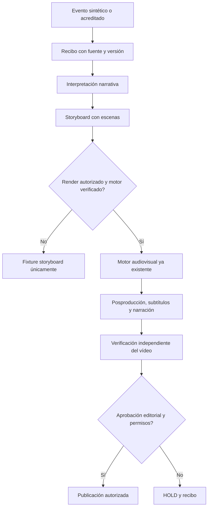

# Ideas26nov · preparación de la Ronda 4
## Visión, cine local y continuidad del ecosistema · reconciliación pública PRE-R6

**Corte documental:** 26 de noviembre de 2026. **Estado:** `PROPOSED / PREPARED_FOR_PART4`, no «Parte 4 recibida», no cuarto lanzamiento de agentes ni transición a la **R4 histórica del SWARM**. Este texto prepara el siguiente documento del autor de Ideas26nov. El **contenido íntegro de una eventual Parte 4 y los contratos U11–U14 no se han recibido**: `NO_DATA(source_part4_not_received)`.

**Fuentes:** [Ideas26nov Parte 1 · StrongDM y P1–P7](CONTINUIDAD-AGENTIC-SWARM-2026-11-26.md), [Parte 2 · N/O y U0–U10](IDEAS26NOV-V03-PARTE2-N-O-U0-U10.md), Parte 3 (IX MCP Tasks, evolución supervisada, navegador aislado, CAMALEÓN v0.3 y Adenda A3, recibida y contrastada contra contratos existentes) y una propuesta de expansión visual/continuidad del 26NOV. Este documento es una **síntesis saneada**: no replica contratos, recibos ni accesos de repositorios privados. No concede grants, identidad de preceptor, firma, merge ni despliegue.

## 0. Tesis y decisiones anteriores

El meta-harness debe hacer evolucionar **los productos y proyectos originales**, no desplazar su desarrollo por actividad exclusivamente autorreferencial. Una función visual nueva solo aporta valor si muestra una interfaz **real**, acredita la versión del artefacto representado y llega al usuario de forma accesible.

La reconciliación privada de la Parte 3 identifica una diferencia decisiva: **una conversación Web puede usar una CLI local mediante el MCP existente, pero solo con permisos efectivos, sesión y GOAL verificados, writer turn cuando aplique y recibo**. Recuperar contexto no hereda ninguno de esos permisos. No adoptar la prohibición global Web→CLI de la plantilla externa ni inventar un puente Web→Web.

**Gobierno sin cambios:** `R5_WORK_CYCLE=CLOSED_ADMINISTRATIVELY_BY_SOVEREIGN`; `R5_TECHNICAL_ACCEPTANCE=HOLD`; `R6=PLAN_ONLY`; `R7=NOT_ACTIVATED`. El término «Ronda 4» de este traspaso es **una entrega de ideas**, no la activación de R4/R6/R7 de ejecución.

## 1. Inventario y riesgo de deriva entre repositorios

La cuenta se ha reconsultado por GitHub: **22 repositorios, 21 activos y 1 archivado** en el corte, incluyendo superficies públicas y privadas. El número **no es una medición de salud** ni demuestra que sus servicios funcionen. La publicación externa no enumera propietarios, rutas, credenciales ni inventarios operativos privados.

| Familia del ecosistema | Producto o dominio de referencia | Primer entregable visual o de recuperación | Responsable de implementación |
|---|---|---|---|
| APP | Experiencia nativa, modelos, accesibilidad | Captura verificable de la versión real y mapa de estados visibles | Titular APP + H/I; ningún panel nuevo por defecto |
| WEB y OpenWorld | Ventana pública, interacción, edificios funcionales | Capturas/demostración de flujo sin fingir nodos LIVE | Titular WEB + H/D |
| LAB / STUDY | Pruebas y transferencia del aprendizaje | Banco de fixtures de visión/coste y resultados reproducibles | Propietario del repo correspondiente + G/D |
| Babel / Atlas / Roadmap | Vocabulario, inventario, prioridades | Censo de dependencias con estados `EXISTING / HOLD / NO_DATA` | Propietarios actuales, C y NEXO como lectores |
| Companion / comunidad | Colaboración y comunicación pública | README, diagramas, tarjetas y alt text con procedencia | Titular producto y responsable de publicación |
| Transporte / gobierno / runtime | Herramientas, permisos, recibos y control | Matriz de entrega al consumidor y pruebas de regresión | Titulares existentes; sin segunda autoridad |
| CineK | Estudio audiovisual con gobierno independiente | Recuperación de pipeline histórico y storyboard sintético | Gobierno del propio proyecto; colaboración únicamente autorizada |
| TextCAD | Generación 3D y validación visual | Comparación de referencia y salida verificada | Titular TextCAD |
| Perfil, estudio público y archivo | Descubrimiento externo e historia | Índice claro, enlaces íntegros, límites y artefactos accesibles | Propietario de publicación / archivo |

**Matriz de continuidad por repositorio (sugerida, no colectada aquí):** `repo, visibilidad, archived, owner, HEAD exacto, última evidencia, capacidades reutilizables, consumidores, deuda, bloqueos, recurso necesario, siguiente unidad, review, observed_at`. **No publicar rutas privadas ni identidades técnicas en el índice externo.** Una carpeta antigua o ausencia de commits recientes no basta para clasificar un repo como «abandonado». La falta de señales es `NO_DATA(last_effective_runtime_not_verified)`.

**Indicador propuesto:** proporción de repositorios con dueño, HEAD y siguiente unidad acreditados; tendencia de tiempo desde última entrega útil; número de capacidades SWARM transferidas efectivamente al consumidor. **Baselines de rendimiento transversal: `NO_DATA(not_measured)`.**

## 2. S · VISION — especialización candidata, no nuevo proceso

**Problema:** la APP, WEB y el trabajo de modelos avanzan sin el material visual confiable necesario para explicar qué existe y encontrar colaboradores.

**Función propuesta:** estrategia visual y networking con trazabilidad de evidencia. Reutiliza herramientas gráficas, interfaces y pipelines ya disponibles; coordina H (paridad de estados), I/APP, WEB, D (replay), G (modelos) y NEXO. **S es una etiqueta provisional**, a reconciliar con el registro y las capacidades existentes antes de crear `S.md` o un proceso.

**MVP mínimo:** paquete visual reproducible para los cuatro productos nucleares (APP, WEB, LAB y STUDY): por cada repo, captura **auténtica**, HEAD/version, fuente y fecha; una imagen de arquitectura o demostración inerte cuando corresponda; leyenda explícita de lo que NO está conectado; alt text revisado; licencia/permiso de publicación.

**Entregables medibles:** número de proyectos cubiertos, % de piezas con digest/version, % con texto alternativo semánticamente fiel, defectos detectados por D, tiempo de producción e impacto medible de difusión. **No** inventar interfaces o falsificar pruebas LIVE con mocks pulidos.

**Prueba adversarial:** si se entrega una imagen que representa una función no instalada, debe etiquetarse como propuesta o rechazarse como demo; una captura sin source/HEAD verificado queda `HOLD`. Cualquier persona/obra ajena y licencia de recursos requieren comprobación antes de publicar.

## 3. T · MOTION — recuperación audiovisual sin invadir CineK

**Problema:** la generación de eventos audiovisuales y vídeos locales ya tiene antecedentes, pero el motor de cine existente no está conectado de forma verificada al modelo de eventos OpenWorld. Empezar de cero duplicaría esfuerzos.

**Fuente histórica del proyecto:** CineK documenta un render del 31 de octubre con **2 min 22 s de proceso; 1280×720; 32 fps; 3,97 s; H.264**. Es una **medición histórica declarada en la memoria del proyecto**, no una sonda de funcionamiento actual: `NO_DATA(current_cinek_runtime_or_gpu_availability)`.

**Corrección importante de gobierno:** CineK conserva repositorio, CI, despliegue y autoridad **independientes**. Una decisión posterior contempla un **panel CineK en la APP**, sujeto a condiciones de montaje y aprobación, sin fusionar por ello sus gobiernos. También existe una iniciativa de **convergencia/archivo eventual**, pero exige preservar historia, copiar y verificar fuentes por digest, recuperar ramas y trabajo pendiente, validar la integración y obtener decisión soberana explícita. **Nunca borrar ni archivar por este plan.** No reintroducir automáticamente paneles retirados del MVP APP.

**Función propuesta:** T · MOTION como especialización documental (nombre provisional), que inventaría el pipeline CineK, sus componentes exportables y la compatibilidad con el contrato de eventos; no crea un segundo renderizador ni toma el control de CineK.

**Primer MVP, sin render físico:** un evento **sintético y no sensible** de OpenWorld → recibo ficticio etiquetado → guion/storyboard → lista de planos → paquete de reproducción de prueba, sin ejecución de GPU. Diferenciar guion verificado, fotogramas reales y vídeo final. D debe poder demostrar que el artefacto se originó en el evento indicado.

**Evolución posterior condicionada:** evento real autorizado → procedencia firmada según contrato → narrativa → storyboard → render local del motor existente → posproducción → subtítulos y audio → verificación → aprobación editorial/publicación. Casos posibles: construcciones, nacimientos de nodos, encuentros, hitos técnicos y relatos documentales. No representar **simulaciones** como hechos históricos.

**Métricas:** tiempo/clip, Wh medidos o estimados separados, coste por segundo útil, fidelidad al evento, porcentaje de subtítulos y accesibilidad, fallos de reconstrucción, revisiones requeridas y tasa de publicación autorizada. Sin runtime actual, consignar `NO_DATA`, no inventar benchmarks.

## 4. L · DELTA FORCE — reutilizar su contrato real

**Conflicto de diseño:** L **ya tiene una ficha**. Su dominio definido es evaluación de la **utilidad** de una unidad con categorías `USEFUL_DELTA / NOISE / INCOMPLETE / REGRESSION / NO_DATA`, métricas de valor y coste. Sustituirlo sin más por un «recolector de repositorios» destruiría ese contrato y duplicaría a C (grafo), NEXO (coordinación), Atlas (inventario) y F (presupuesto).

**Adaptación mínima recomendada:** la **continuidad del ecosistema es una nueva fuente de evidencia para L**, no una nueva autoridad de inventario. C/Atlas recopilan la matriz, NEXO asigna unidades y L evalúa si la transferencia aportó valor verificable. Si se propone formalizar una ampliación de `L.md`, requiere titular, review y autorización específica.

**MVP:** matriz de continuidad producida por el mecanismo existente + juicio L de cinco unidades **con** y **sin** intervención de recuperación, D como revisor separado. `NO_DATA` nunca se transforma en `NOISE`.

## 5. Cadena de cine de eventos OpenWorld · diseño conceptual



**Límite:** `source_ref`/versionado del evento, derechos del material, usuario/editor autorizante y estado de render son elementos distintos. Un testigo real de OpenWorld no autoriza por sí solo un gasto GPU, exposición pública o uso de imágenes de personas.

## 6. Reconciliación con Ideas26nov Partes 1–3 y A3

| Patrón previo | Aporte a la Ronda 4 visual | Estado y prueba requerida |
|---|---|---|
| P1 / U1 fencing | Un solo propietario de archivo, pestaña o render; rechazo de tareas obsoletas en el receptor | **HOLD** hasta prueba de efecto real, no basta CLAIM |
| P2 paginación | Inventarios de assets, modelos, episodios y eventos sin falsos `complete` | Fixtures de cambios entre páginas y filtro |
| P3 / U0 identidad | Quién originó el evento y quién autorizó imagen o película | No inferir identidad de metadatos de texto |
| P4 / U4 costes | Medir energía/atención y capacidad de render | Wh locales vs estimados remotos separados |
| P5 / D juez | Comparación de captura/clip con fuente exacta y refutación de afirmaciones | Verificar sobre HEAD final, no intermedio |
| P6 / U9 accesibilidad | Visual/voz/máquina expresan el mismo `state/cause/source/observed_at/evidence_ref` | Alt text, subtítulos, locución, lector físico por puerta separada |
| P7 fail-safe | Abortar render, recuperar sin duplicar, revertir publicación | Sonda final; cancel ACK no demuestra parada |
| U7 MCP Tasks | Render de larga duración con handle durable y auth por solicitud | **PROPOSED**; contrato local / integración E2E no acreditados |
| U8 skills anti-drift | Plantillas de storyboard y publicación propuestas, revisadas y bloqueables | Nunca autoaplicar una mejora ni minar secretos |
| U10 CAMALEÓN | Recuperar estado editorial sin heredar permisos ni writer | Contrato privado anterior conserva Web→CLI autorizable y RETURN; propuesta externa no canónica |
| A3 seguridad | Escaneo de inputs no confiables, licencias, hallazgos y regresiones con oráculos | **PROPOSED**, sin instalar scanners ni probar secretos reales |

La Adenda A3 de la Parte 3 menciona una **«Parte 4» con U11–U14**. **No existen contratos de esas unidades aportados todavía:** `NO_DATA(source_U11_U14_not_received)`. Un nuevo texto puede proponerse como Parte 4, pero **no se pueden anticipar U11–U14 como aceptadas** por su sola enumeración.

### Cuestiones necesarias para el autor de la próxima entrega

- ¿U11–U14 son unidades visuales, de seguridad o mixtas? Proporcionar texto completo, fuente, titular, dependencia y prueba; **no** reutilizar un número con otro significado.
- ¿S/T son roles que hacen falta o funciones cubribles desde H/I/G y el propietario de CineK? Medir duplicidad antes de dar identidad.
- ¿Qué entrega visual puede reconstruirse **hoy** desde la versión vigente y cuál es un mock? Adjuntar evidencia de procedencia.
- ¿Qué repos públicos precisan mejor arte visual antes que cambios del meta-harness? Registrar utilidad por consumidor, no por commits.
- ¿Cómo se garantiza que la APP actual no recupera un panel retirado sin decisión y que CineK mantiene su independencia?
- ¿Qué evidencia mínima separa render histórico, render actual, storyboard y clip publicado?
- ¿Cuándo un evento OpenWorld es apto para relato/uso de GPU/publicación y quién lo autoriza?
- ¿Qué prueba física con lector de pantalla y qué versión accesible con subtítulos/voz se necesitarán para declarar utilidad real?

## 7. Presupuesto y secuencia de trabajo

**Distribución tentativa, no obligación medida:** 50 % evolución de productos; 30 % reparación/continuidad de repositorios; 20 % evolución del harness. F ajustará por coste de cambiar de tarea, prioridad efectiva, dependencias, recursos y valor útil comprobado. **NO_DATA(actual_capacity_distribution)**.

| Etapa *visual* | Entrega falsable | Gate |
|---|---|---|
| **V0 · RECOVER** | Matriz de repositorios + mapa de assets y flujos CineK/TextCAD existentes | Fuentes + HEAD + dueño; sin sustituir el inventario existente |
| **V1 · VISUAL IDENTITY** | Pack de capturas reales y textos alternativos de APP/WEB/LAB/STUDY | Estado de función y versión contrastados |
| **V2 · DEMO** | Demostración reproducible de un flujo real de WEB/APP | D compara evidencia; no LIVE por mock |
| **V3 · CINEK RECOVERY** | Auditoría del pipeline que ya existe; sonda de solo lectura y licencia | CineK autoriza y conserva gobierno propio |
| **V4 · EVENT→STORYBOARD** | Fixture sintético reproducible de OpenWorld → guion + planos | No GPU/efecto real por defecto |
| **V5 · EVENT→FILM** | Un clip de prueba realizado por motor existente, solo con autorización específica | Coste, sonda y permiso de publicación separados |
| **V6 · NETWORKING / TRANSFER** | Paquete compartible accesible + traspaso a consumidores/Hexelion | Revisión editorial, licencias y paridad Acho |

Esta **secuencia V0–V6** no modifica R5, R6, R7 ni sus gates. V5 requiere autorización adicional: la orden de documentar Ronda 4 **no** la contiene.

## 8. Manifestación mínima de cada idea para la futura Parte 4

```yaml
source: "Ideas26nov · Parte 4 · NO_DATA(not_received)"
proposal_id: "R4-VIS-<id>"
status: "PROPOSED"
problem: "qué capacidad o proyecto real está retrasado"
source_version: "repo público / HEAD y observed_at, o NO_DATA(cause)"
existing_component: "ruta/contrato ya existente, sin credenciales"
owner_existing: "titular del producto + revisor independiente"
new_role_needed: false
proposed_role: "S/T provisional, solo si se demuestra hueco"
authorization_boundary: "sin grants, identidad nueva o render/publicación por documento"
minimal_delta: "una pieza sin cambiar otro dominio"
artifacts: ["imagen o storyboard con procedencia", "recibo", "alt text / subtítulos cuando aplique"]
tests: ["captura vs versión", "paridad accesible", "evento ficticio no presentado como LIVE", "no duplicar pipelines", "rollback"]
benefit_measurement: "numerador, denominador, baseline, atención humana, energía atribuible"
risks: ["licencia", "privacidad", "gasto GPU", "deriva del MVP APP", "concurrencia"]
decision: "KEEP_PATTERN | HOLD | DISCARD"
next: "pieza concreta y propietario; PR revisable solo si se autoriza"
```

## 9. Puertas de aceptación de la futura Parte 4

1. **Fuentes reales**: leer contratos de SWARM y repos afectados en sus HEAD vigentes; cambios ajenos no sustituyen comisión.
2. **Identidades**: S/T **PROPOSED** y L **preservado**; no sumar procesos sin autorización.
3. **CineK**: independencia + decisión de panel + condiciones de posible convergencia representadas sin mezclarlas; no archivo/borrado automático.
4. **22 repos**: censo de existencia comprobado; salud y funcionamiento no inferidos, `NO_DATA(causa)` por proyecto.
5. **Arte visual**: captura real con fuente/versión; mock identificado; alt text y subtítulos coherentes.
6. **Evento→vídeo**: fixture sin efectos antes de render real, y gates distintos para gasto GPU y publicación.
7. **Continuidad L**: no reemplazar su contrato de evaluación por otro coordinador.
8. **A3/U11–U14**: no inventar Parte 4 ni llamar aceptadas esas unidades sin texto y revisión.
9. **R5/R6/R7**: cierre administrativo y aceptación técnica separados; no mover gates.
10. **Gobierno**: cambios en MD/roles, licencias, grants, instalación, convergencia y publicación autorizados solo por su procedimiento.
11. **Evidencia**: `SOURCE / VERIFIED / INFERENCE`; `NO_DATA` con causa, prueba de salida y fecha.
12. **Accesibilidad**: mismo estado para pantalla, voz y datos, y prueba física separada antes de anunciarla.

## 10. Mensaje de traspaso para el autor

> **Ideas26nov · Ronda 4 (propuesta, todavía no recibida).** Construye el texto siguiente a partir del censo de 22 repositorios y las Partes 1–3, incluyendo la Adenda A3 y los posibles U11–U14 **solo si aportas su contrato íntegro**. La prioridad es recuperar productos originales y capacidades visuales reales: imágenes, networking, CineK independiente y eventos de OpenWorld con audiovisual reproducible. Contrasta S/T como identidades candidatas, no activadas, y L contra su dominio vigente de medición de utilidad. Usa el pipeline cinematográfico existente; no dupliques servicios. Separa SOURCE/VERIFIED/INFERENCE; describe el MVP mínimo, la prueba adversarial, el ahorro medible, la licencia, el rollback, la accesibilidad y la decisión reservada. No modifiques por esta propuesta la comisión, CAMALEÓN, el esquema de permisos ni los gates. Entrega un texto apto para reconciliación privada antes de activar cualquier carril.

**Salida esperada:** propuesta de Ronda 4 **redactada por su autor** y entregada al orquestador, que la contrastará después con el HEAD vigente; no se presume aprobada, implementada ni desplegada.
